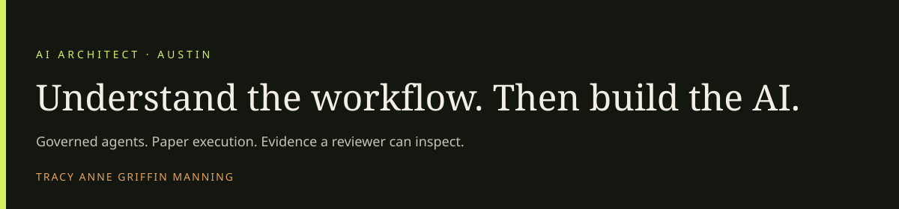

AI Architect · Austin, Texas · [Website](https://tam-ds.github.io/) · [Email](mailto:tmanning@post.harvard.edu) · [LinkedIn](https://www.linkedin.com/in/tracymanning) · [X](https://x.com/TAGM2025)

I design agentic systems where a model can propose and cannot grant itself permission. Financial services trained the consequence. Founding trained the ownership. The public repos are the parts a reviewer can inspect.

**Current:** Founder, Apex AI|ML. **Prior:** Minotaur Consulting · Office of the CIO 

## Eight featured projects

| Order | Repository | Sector | What it Proves |
| --- | --- | --- | --- |
| 01 | [Agent Foundry](https://github.com/TAM-DS/agent-foundry) |Enterprise AI | Capability, identity, and runtime grants are separate. 399 tests. AWS DEV. |
| 02 | [Monster Heavy](https://github.com/TAM-DS/monster-heavy) | Capital Markets| Durable paper execution survives retry, concurrency, and worker death. | 
| 03 | [AI-Ready Data Platform](https://github.com/TAM-DS/ai-ready-data-platform) | Retail Analytics | Three specialists. Claims checked against bounded facts. | 
| 04 | [Capital Markets Research desk](https://github.com/TAM-DS/capital-markets-research-desk) | Energy Trading | Massive historical evidence, fixed-rule holdout, and checked CrewAI research. | 
| 05 | [Investment gems](https://github.com/TAM-DS/investment-gems) | Suggestion Engine | Explicit momentum, volatility, and liquidity hurdles; bounded CrewAI challenge. |
| 06 | [Paper trading floor](https://github.com/TAM-DS/paper-trading-floor) | Multi-Agent MCP | Local human confirmation, independent account checks, and persistent simulated fills.|
| 07 | [BALLAST](https://github.com/TAM-DS/ballast) | Supply-Chain | Explainable supply-chain risk, what-if shocks, and a disruptive-action approval gate. | 
| 08 | [AEGIS Evidence](https://github.com/TAM-DS/aegis-evidence) | Cyber-Security | Replayable SOC assurance workpaper, human acceptance, open gaps, and SHA-256-verifiable archives. | 

These eight projects show depth in governed AI and breadth across capital markets, energy, supply chain, and cybersecurity assurance. BALLAST makes operational trade-offs visible; AEGIS Evidence makes governance claims and unresolved control gaps inspectable.

Monster Light and Monster Desk remain supporting paper-boundary examples alongside Monster Heavy.

## The rule

A recommendation is not permission. Approval is bound to the exact action. Current evidence is checked again at execution. If the control cannot be shown, the claim is not made.

## Gradio dashboards: supply-chain and cybersecurity risk

**Business risk crosses departments. The workflow should connect the pieces.**

I use [Gradio](https://www.gradio.app/) to turn Python workflows into interactive interfaces that business reviewers can explore. Gradio's team [reported more than one million monthly developers in April 2025](https://huggingface.co/blog/gradio-1m), and its integration with Hugging Face Spaces supports rapid demonstration and sharing.

**Three lines create the interface. The engineering behind it makes the workflow worth using.**

```python
import gradio as gr
demo = gr.Interface(fn=analyze_risk, inputs="text", outputs="text")
demo.launch()
```

*Illustrative interface example: `analyze_risk` is an existing Python function. BALLAST and AEGIS Analyst use richer layouts and explicit workflow controls.*

[](https://github.com/gradio-app/gradio)

- **[BALLAST — Gradio supply-chain control tower](https://github.com/TAM-DS/ballast#see-the-two-scenarios):** energy shipping routes and Taiwan semiconductor dependencies make concentration, single-source exposure, and disruption visible. Operators compare baseline and what-if scenarios, inspect risk drivers, and explicitly approve disruptive mitigation simulations.
- **[AEGIS Analyst — Gradio cybersecurity console](https://github.com/TAM-DS/aegis-analyst):** seeded security alerts become analyst briefs, ATT&CK mappings, and containment proposals. Host isolation requires explicit approval before the sandbox returns a simulated result. Its **[AEGIS Evidence companion](https://github.com/TAM-DS/aegis-evidence#see-the-workpaper)** uses Streamlit to expose control declarations, human acceptance, unresolved gaps, and verifiable evidence archives.

Together, these workflows connect supplier resilience, energy exposure, semiconductor dependencies, security operations, and accountable decisions. The demonstrations use seeded or synthetic scenarios; mitigation and containment are simulated. The business value is making the risks, trade-offs, and authority boundaries inspectable before operational changes.

## Streamlit trading dashboards

Three interactive local applications combine [Massive](https://massive.com/) historical daily market evidence, Python-calculated metrics, and bounded [CrewAI](https://crewai.com/) research. Structured claims are checked against the supplied evidence; interpretation still requires human review. Agents have no order tools. Only the paper floor records simulated fills, after explicit local confirmation and account checks.

- [Capital Markets Research Desk](https://github.com/TAM-DS/capital-markets-research-desk#application-screenshots) pairs a research brief with a fixed-rule chronological holdout, benchmark comparison, and visible cost assumptions.
- [Investment Gems](https://github.com/TAM-DS/investment-gems#application-screenshots) applies transparent momentum, volatility, and liquidity hurdles to a selected equity/ETF universe.
- [Paper Trading Floor](https://github.com/TAM-DS/paper-trading-floor#application-screenshots) retains simulated cash, positions, and an evidence-linked SQLite fill ledger across restarts.

Each repository includes screenshots, setup instructions, tests, and explicit limitations. Data are end-of-day historical observations; price returns exclude dividends. Energy equities and ETFs are proxies, not ERCOT power or Henry Hub spot feeds. There is no broker connection or real-money execution path. The original static fixture views remain documented as legacy examples.

## What is not public

**Evidence scope and confidentiality**

Confidential client material is not published. Public FinOps repositories contain modeled scenarios with documented formulas and assumptions.


