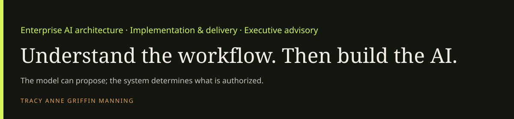

**AI Architect**  
Based in Austin; open to San Antonio, Dallas–Fort Worth, and Houston; in-office or hybrid; open to meaningful business travel.  
[Website](https://tam-ds.github.io/) · [Email](mailto:tmanning@post.harvard.edu) · [LinkedIn](https://www.linkedin.com/in/tracymanning) · [X](https://x.com/TAGM2025)

I build enterprise AI for decisions where money, risk, and accountability matter—connecting financial-services experience with AI architecture, infrastructure economics, and controlled execution.

**Current:** Founder, Apex AI|ML  
**Prior:** Minotaur Consulting · Office of the CIO · Wall Street

---

## What I bring — three areas of impact

Business value first. Inspectable engineering behind every claim.

### 01 / AI Strategy & Infrastructure Economics

**Make the economics inspectable.** Translate AI architecture into cost, performance, and risk trade-offs that executives can evaluate before committing capital.

- **[AI-Ready Data Platform](https://github.com/TAM-DS/ai-ready-data-platform)** — Bounded business claims and deterministic reconciliation.
- **[FinOps for M&A Infrastructure DD](https://github.com/TAM-DS/Infrastructure_Deal_Room-FinOps-M_and_A)** — Infrastructure diligence, remediation costs, and financial sensitivity.
- **[AI Infrastructure Intelligence](https://github.com/TAM-DS/AI_Infra_Command_Tower-FinOps)** — Multi-cloud spend, GPU costs, and optimization scenarios.

**Evidence:** [Review the financial assumptions](https://github.com/TAM-DS/Infrastructure_Deal_Room-FinOps-M_and_A/blob/main/docs/ASSUMPTIONS.md).  
*Published FinOps figures are synthetic and modeled; career outcomes are separate.*

### 02 / AI Governance, Cyber Risk & Audit Evidence

**Make accountability visible.** Build explicit authorization boundaries, accountable ownership, and traceable evidence for human review.

- **[VANGUARD-Guard](https://github.com/TAM-DS/VANGUARD-Guard)** — AI inventory, risk assessment, and ownership workflows.
- **[AEGIS-NHI](https://github.com/TAM-DS/AEGIS-NHI)** — Connected investigations and modeled financial exposure.
- **[AEGIS Evidence](https://github.com/TAM-DS/aegis-evidence)** — Replayable workpapers and SHA-256-verifiable archives.
- **[GuardRails-MCP](https://github.com/TAM-DS/guardrails-mcp)** — Prompt-regression checks and human release-review evidence.

**Evidence:** [Inspect an evidence-linked decision brief](https://github.com/TAM-DS/AEGIS-NHI/blob/main/docs/CONNECTED_INVESTIGATION.md#evidence-linked-decision-brief).  
*Reference workflows and synthetic cases; framework mappings are not certification.*

### 03 / Capital Markets, Energy & Reliable Execution

**Keep research and execution accountable.** Connect financial and operational context with research tools, supply-chain decision support, and controlled execution.

- **[Capital Markets Research Desk](https://github.com/TAM-DS/capital-markets-research-desk)** — Historical research and fixed-rule holdout evaluation.
- **[Energy Equity Investment Gems](https://github.com/TAM-DS/energy-equity-investment-gems)** — Explicit momentum, volatility, and liquidity screening.
- **[BALLAST](https://github.com/TAM-DS/ballast)** — Energy-route and semiconductor supply-chain scenarios.
- **[Monster Heavy](https://github.com/TAM-DS/monster-heavy)** — Governed paper execution, retries, concurrency, and recovery.
- **[Paper Trading Floor](https://github.com/TAM-DS/paper-trading-floor)** — Persistent paper ledger with cash checks and replay protection.

**Evidence:** [Inspect worker-recovery and retry tests](https://github.com/TAM-DS/monster-heavy/blob/main/tests/integration/test_recovery_release.py).  
*Historical research and simulated execution; no live trading or investment-return claims.*

### Enterprise integration in practice

**[SignalDesk](https://github.com/TAM-DS/SignalDesk-Acquisition-Intelligence)** connects evidence-linked sales research with bounded, read-only Salesforce access, opt-out checks, and human-authorized outreach decisions. Its Salesforce GET-only implementation was selected by the XERJ team for its public code-reference corpus. Developer-org and simulated-HTTP evidence; no automated CRM writes or outreach.

**Prior career outcomes:** $1.2M+ annual cloud savings · 70% less manual reporting · platforms supporting 10,000+ daily users. These are professional-history outcomes, separate from portfolio simulations.

**Operating principle:** The model can propose. The system determines what is authorized.

---

## Multi-model engineering & runtime architecture

**The model is a component. The architecture is the product.**

I assess OpenAI GPT/Codex, Anthropic Claude, Google Gemini, and xAI Grok according to workload fit: reasoning and structured output, code and tool-use workflows, context requirements, retrieval, latency, cost, and failure behavior. **Model evaluation is not the same as a deployed four-provider orchestration layer.**

The governing design principle remains independent of provider: **explicit tool grants, deterministic policy checks, source-linked evidence, bounded execution, and human accountability.** See [SignalDesk](https://github.com/TAM-DS/SignalDesk-Acquisition-Intelligence), [AEGIS-NHI](https://github.com/TAM-DS/AEGIS-NHI), and [Agent Foundry](https://github.com/TAM-DS/agent-foundry) for inspectable examples of these boundaries.

---

## Open-source reference engineering

**XERJ Corpus Hub selection (2026) — SignalDesk Salesforce GET-only integration**

The XERJ team selected a bounded Salesforce GET-only preview implementation from [SignalDesk](https://github.com/TAM-DS/SignalDesk-Acquisition-Intelligence) for inclusion in its public code-reference corpus. The selected work focuses on validation, fail-closed behavior, opt-out checks, and deterministic restrictions around enterprise API access.

**Engineering lesson:** The model may propose; the system determines what is authorized.

*Selection for indexing is external recognition of an implementation—not certification, formal peer review, a universal reference standard, proof of agent adoption, or measured token savings. A direct corpus citation can be added when publicly verified.*

---

## Supporting engineering depth

[Agent Foundry](https://github.com/TAM-DS/agent-foundry) separates capability, identity, and runtime grants, with a documented AWS DEV proof. Supporting boundary examples include [Monster Desk](https://github.com/TAM-DS/monster-desk), [Monster Light](https://github.com/TAM-DS/monster-light-v0.1-v0.2), and [AEGIS Analyst](https://github.com/TAM-DS/aegis-analyst).

---

## Data & platform foundations

| Repository | Focus |
|---|---|
| **[Databricks AI-Ready Lakehouse](https://github.com/TAM-DS/databricks-ai-ready-lakehouse)** | Governed Spark / PySpark pipelines, Unity Catalog, Delta Lake, read-only MCP boundaries |
| **[Idempotent Data Engineering Foundation](https://github.com/TAM-DS/Idempotent-Data-Engineering-Foundation-System)** | One-command path from raw CSV to market intelligence with true idempotency |
| **[FinOps for M&A Infrastructure DD](https://github.com/TAM-DS/Infrastructure_Deal_Room-FinOps-M_and_A)** | Modeled multi-cloud infrastructure risk scenarios (illustrative savings, not a client result) |
| **[AI Infrastructure Intelligence](https://github.com/TAM-DS/AI_Infra_Command_Tower-FinOps)** | Modeled multi-cloud GPU cost scenarios |

---

## Try a demo

**[Open the interactive BALLAST walkthrough](https://tam-ds.github.io/demo.html)** — no login, installation, or API key. Compare synthetic energy and semiconductor scenarios and replay denied versus approved mitigation outcomes.

This hosted browser walkthrough uses precomputed results from the Python engine. It is not a hosted Python backend, authenticated approval service, or live trading system. [Inspect the exporter](https://github.com/TAM-DS/ballast/blob/main/scripts/export_demo.py) and [CI results](https://github.com/TAM-DS/ballast/actions/workflows/ci.yml).

### Run the full applications locally

Each repository documents its dependencies and entry points.

**Gradio**
- [BALLAST](https://github.com/TAM-DS/ballast) — supply-chain control tower (energy routes, semiconductor concentration, approval-gated mitigation)
- [AEGIS Analyst](https://github.com/TAM-DS/aegis-analyst) — SOC analyst console with policy checks and sandboxed actions

**Streamlit trading workbenches** (historical daily data + Python metrics + bounded CrewAI; agents have no order tools)
- [Capital Markets Research Desk](https://github.com/TAM-DS/capital-markets-research-desk)
- [Energy Equity Investment Gems](https://github.com/TAM-DS/energy-equity-investment-gems)
- [Paper Trading Floor](https://github.com/TAM-DS/paper-trading-floor)

```bash
# typical Streamlit entry
python -m streamlit run app.py
```

---

## What I bring

**Enterprise AI implementation & delivery · C-suite advisory · agentic AI architecture & governance · technical pre-sales.**

Verifiable shipped code. Python, cloud architecture, and MCP integration. Bounded tool authority and model evaluation. Founder-level ownership. Translation from an executive business problem to a reviewed technical decision.

These are reference implementations. They demonstrate architecture and controls a reviewer can inspect—not claims of paying customers or enterprise production deployment.


